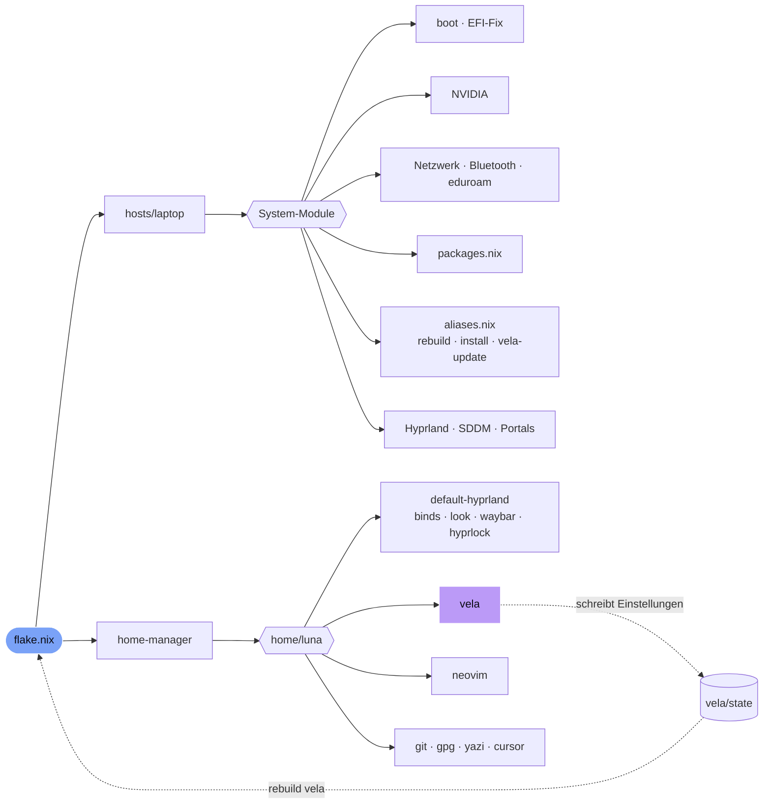

<p align="center">
  
</p>

<p align="center">
  <a href="https://nixos.org"></a>
  
  
  
  <br>
  
  
  <a href="LICENSE"></a>
</p>

<h3 align="center">Mein kompletter Laptop als Code: vom Bootloader bis zur Blur-Stärke hinter der Waybar.</h3>

<p align="center">
  Ein <code>git clone</code>, ein <code>rebuild</code>, und das System steht wieder genau so da.<br>
  Glas, Blur, abgerundete Ecken, und darunter Nix, das sich um alles kümmert.
</p>

---

## ✦ Auf einen Blick

| | |
|---|---|
| **System** | NixOS `nixos-unstable`, Flakes, `x86_64-linux`, systemd-boot, Dual-Boot mit Windows |
| **Desktop** | Hyprland (Config in **Lua** statt hyprlang), SDDM mit Catppuccin Mocha |
| **Shell** | [vela](https://github.com/raindancer118/vela) als Launcher, Control Center, Benachrichtigungen und OSD, dazu Waybar und Hyprlock |
| **Terminal** | Ghostty (50 % transparent), Starship-Prompt, Nerdfetch beim Öffnen |
| **Editor** | Neovim mit Tokyo Night, Treesitter (alle Grammatiken), LSP, Telescope, Lazygit |
| **Look** | 25 px Rundung, 3-fach Kawase-Blur auf allen Layern, weißer 1-px-Rahmen am aktiven Fenster, Adwaita-dark und Papirus |
| **GPU** | NVIDIA (Beta-Treiber, DRM-Modesetting, Wayland-Fixes) |
| **Extras** | Docker, Steam, Prism Launcher, Spotify, Zen Browser, Claude Code und Claude Desktop |

---

## ✦ Die Befehle

Das Repo bringt eigene Kommandos mit, damit man nie wieder `nixos-rebuild` von Hand tippt.

### `rebuild` 🔁

```bash
rebuild                        # committen + umschalten
rebuild "Waybar aufgeräumt"    # mit eigener Commit-Message
```

`rebuild` staged alles, **lässt Claude (Haiku) aus dem Diff eine deutsche Commit-Message schreiben** und führt dann `nixos-rebuild switch` aus. Ohne Netz oder ohne `claude` nimmt es einfach die Namen der geänderten Dateien. Jede Änderung am System landet so automatisch in der Git-History.

### `install` / `remove` 📦

```bash
install cowsay lolcat   # trägt die Pakete in packages.nix ein und rebuildet
remove cowsay           # und wieder raus
```

Die Skripte bearbeiten nur den Block zwischen `# BEGIN AUTO PACKAGES` und `# END AUTO PACKAGES` in [`modules/packages.nix`](dotfiles/modules/packages.nix). Der handgepflegte Rest bleibt unangetastet.

### `vela-update` 🌙

```bash
vela-update                     # läuft im Hintergrund weiter
journalctl --user -fu vela-update
```

Aktualisiert den vela-Input und baut das neue System **im Hintergrund** als systemd-User-Unit. Wenn das WLAN wegbricht, pausiert es und macht nach dem Reconnect weiter. Fertig gebaute Store-Pfade bleiben dabei erhalten. Es meldet sich per Benachrichtigung und warnt, wenn vela neue `setup()`-Argumente eingeführt hat, die nachgezogen werden müssen. Umgeschaltet wird danach ganz normal mit `rebuild`.

### Aufräumen 🧹

| Alias | Was er macht |
|---|---|
| `update` | `nix flake update` für alle Inputs |
| `garbage` | `nix-collect-garbage` |
| `clear_efi` | löscht alle System-Generationen bis auf die letzten 5 |
| `clean` | beides zusammen |

---

## ✦ Shortcuts

`Super` ist die Mod-Taste.

| Taste | Aktion | | Taste | Aktion |
|---|---|---|---|---|
| <kbd>Super</kbd> <kbd>Q</kbd> | Terminal (Ghostty) | | <kbd>Super</kbd> <kbd>R</kbd> | App-Launcher (vela) |
| <kbd>Super</kbd> <kbd>E</kbd> | Dateien (Nautilus) | | <kbd>Super</kbd> <kbd>B</kbd> | Control Center (vela) |
| <kbd>Super</kbd> <kbd>C</kbd> | Fenster schließen | | <kbd>Super</kbd> <kbd>V</kbd> | Zwischenablage-Verlauf |
| <kbd>Super</kbd> <kbd>F</kbd> | Vollbild | | <kbd>Super</kbd> <kbd>D</kbd> | Screenshot von einem Bereich |
| <kbd>Super</kbd> <kbd>T</kbd> | Floating an/aus | | <kbd>Super</kbd> <kbd>L</kbd> | Sperren (Hyprlock) |
| <kbd>Super</kbd> <kbd>P</kbd> | Fenster anpinnen | | <kbd>Super</kbd> <kbd>J</kbd> | Split drehen |
| <kbd>Super</kbd> <kbd>1</kbd>…<kbd>0</kbd> | Workspace 1–10 | | <kbd>Super</kbd> <kbd>⇧</kbd> <kbd>1</kbd>…<kbd>0</kbd> | Fenster dorthin schieben |
| <kbd>Super</kbd> <kbd>Tab</kbd> / <kbd>→</kbd> | nächster Workspace | | <kbd>Alt</kbd> <kbd>Tab</kbd> | vorheriger Workspace |
| <kbd>Super</kbd> <kbd>S</kbd> | Scratchpad „magic“ | | <kbd>Super</kbd> <kbd>⇧</kbd> <kbd>S</kbd> | Fenster ins Scratchpad |
| <kbd>Super</kbd> + Linksklick | Fenster ziehen | | <kbd>Super</kbd> + Rechtsklick | Fenster skalieren |
| <kbd>Super</kbd> <kbd>Space</kbd> | Spotify Play/Pause (startet es bei Bedarf) | | <kbd>Super</kbd> <kbd>.</kbd> / <kbd>,</kbd> | nächster / vorheriger Song |
| <kbd>Super</kbd> <kbd>Z</kbd> | Shuffle an/aus | | <kbd>Super</kbd> <kbd>W</kbd> | Repeat: aus → Playlist → Song |

Screenshots landen als JPG in `~/Pictures/Screenshots` und gleichzeitig **als PNG in der Zwischenablage**, weil Claude Code nur `image/png` aus der Zwischenablage liest. Medien-, Lautstärke- und Helligkeitstasten funktionieren auch auf dem Sperrbildschirm.

---

## ✦ Wie alles zusammenhängt



Persönliche Werte wie Benutzername, Name, Monitor, Git-Identität und NVIDIA-Variante stehen als `let`-Bindings ganz oben in [`flake.nix`](dotfiles/flake.nix) und werden per `specialArgs` an alle Module durchgereicht.

### vela: Einstellungen per Klick, trotzdem deklarativ

vela weiß, dass es auf NixOS läuft. Alles, was man in den vela-Settings umstellt (Hyprland-Optionen, Shortcuts, Launcher-Look), landet nicht in `~/.config`, sondern in [`home/luna/modules/vela/state/`](dotfiles/home/luna/modules/vela/state) **im Repo**. „Apply & rebuild“ ruft dann `rebuild vela` auf und committet die Änderung. Klicken und trotzdem reproduzierbar bleiben.

---

## ✦ Details, auf die ich stolz bin

<details>
<summary><b>🪟 Windows klaut den Bootloader? Nicht mehr.</b></summary>

<br>

Windows und die HP-Firmware schieben den „Windows Boot Manager“ immer wieder auf Platz 1 der UEFI-Bootreihenfolge. Ein systemd-Service in [`boot.nix`](dotfiles/modules/boot.nix) rückt das bei jedem Linux-Start wieder zurecht und filtert dabei die toten Boot-IDs heraus, die die HP-Firmware gerne stehen lässt und an denen `efibootmgr -o` sonst scheitert.
</details>

<details>
<summary><b>🌏 Die Zeitzone stellt sich von selbst um.</b></summary>

<br>

`tzupdate` setzt die Zeitzone beim Booten und danach stündlich per IP-Geolocation. Perfekt für Reisen: Der Laptop landet und ist schon auf Ortszeit. Damit Koreanisch nicht als Tofu-Kästchen erscheint, sind die Noto-CJK-Fonts als Fallback hinter JetBrains Mono eingetragen.
</details>

<details>
<summary><b>🎵 Spotify wohnt auf Workspace 3.</b></summary>

<br>

Spotify startet still auf seinem eigenen Workspace, und <kbd>Super</kbd> <kbd>Space</kbd> weckt es bei Bedarf auf, ohne dass man den Workspace wechseln muss. Nach dem Start spielt der erste Druck auf Play den letzten Song **von vorne**, statt mitten im Takt weiterzumachen. Shuffle und Repeat melden sich mit einer kleinen Benachrichtigung.
</details>

<details>
<summary><b>🔄 vela-Updates ohne Neu-Anmelden.</b></summary>

<br>

vela erkennt Updates eigentlich daran, dass sich die eigene Binary ändert, was unter NixOS mit jedem neuen Store-Pfad passiert. Ein Activation-Script sucht deshalb nach dem Rebuild veraltete Instanzen (Shell, Idle, Pulse), beendet sie und startet sie über Hyprland in der neuen Version neu. Außerdem lädt es den Launcher neu, damit frisch installierte Apps sofort erscheinen.
</details>

<details>
<summary><b>🧩 Kleine Wrapper, große Wirkung.</b></summary>

<br>

- **Zen Browser** bekommt `ffmpeg` in den Library-Pfad, sonst gibt es kein H.264.
- **Prism Launcher** startet ohne `QT_QPA_PLATFORMTHEME`, weil sich sonst GTK2- und GTK3-Styles im selben Prozess in die Quere kommen und alles mit einem Segfault abstürzt.
- **iloader** ist per `overrideAttrs` auf 2.3.8 hochgezogen (nixpkgs hängt noch bei 2.3.3), samt neuer Hashes für Quellcode, Node-Module und Cargo.
- **nix-ld** ist an, damit vorgebaute Binaries ohne Nix-Patching laufen.
</details>

<details>
<summary><b>🧪 Hyprfrost: ein eigenes Hyprland-Plugin (experimentell).</b></summary>

<br>

In [`flakes/hyprfrost`](dotfiles/flakes/hyprfrost) liegt ein selbstgeschriebenes C++-Plugin für Milchglas-Fenster: getönte Fläche plus prozedurales GLSL-Rauschen als „Frost-Korn“ über dem Kawase-Blur. Es ist gerade auskommentiert, aber startklar für den nächsten Ausflug.
</details>

<details>
<summary><b>📱 Flutter-Devshell.</b></summary>

<br>

[`flakes/flutter-dev`](dotfiles/flakes/flutter-dev) ist eine eigene Flake mit Flutter 3.38.9 und Android-SDK, die so gebaut ist, dass sie unter NixOS wirklich funktioniert.
</details>

---

## ✦ Struktur

```text
nixos/
├── update-setup.sh              # Installer für neue Rechner
├── assets/banner.svg            # das Ding da oben ✨
└── dotfiles/
    ├── flake.nix                # Inputs + persönliche Variablen
    ├── first-run.sh             # holt die hardware-configuration.nix
    ├── hosts/laptop/            # Host: importiert alle System-Module
    ├── modules/
    │   ├── aliases.nix          # rebuild · install · remove · vela-update
    │   ├── packages.nix         # Pakete (+ AUTO-PACKAGES-Block)
    │   ├── boot.nix             # systemd-boot + EFI-Bootorder-Fix
    │   ├── desktop/             # Hyprland, SDDM, xdg-Portals
    │   ├── hardware/            # NVIDIA
    │   └── …                    # Netzwerk, Locale, Styling, Docker, Nutzer
    ├── home/luna/
    │   ├── home.nix
    │   └── modules/
    │       ├── default-hyprland/   # Binds, Look, Waybar, Hyprlock, Ghostty …
    │       ├── vela/               # + state/, das vela selbst beschreibt
    │       ├── neovim.nix
    │       └── claude-desktop/
    └── flakes/                  # hyprfrost, flutter-dev
```

---

## ✦ Auf einem neuen Rechner installieren

> [!WARNING]
> `update-setup.sh` ist ein **Hard Reset**: Es löscht das Zielverzeichnis (`--dest`) komplett und ersetzt es durch eine frische Kopie von `dotfiles/` aus GitHub. Gib deshalb immer `--dest` an und zeig damit auf den `dotfiles`-Ordner, nie auf das Repo selbst.

**1. Repo holen** (auf einem frischen NixOS reicht `nix-shell -p git`):

```bash
git clone https://github.com/Luna1506/nixos.git ~/nixos
cd ~/nixos
```

**2. An dich anpassen.** Das Skript patcht die Variablen in `flake.nix` und kopiert über `first-run.sh` deine `hardware-configuration.nix` an die richtige Stelle:

```bash
./update-setup.sh --username tim --fullname "Tim Beispiel" \
  --git-name "Tim" --git-email "tim@example.com" \
  --monitor HDMI-A-1 --nvidia-alt true \
  --dest ~/nixos/dotfiles
```

**3. Das erste Mal bauen.** Die Befehle aus dem Repo gibt es erst danach:

```bash
sudo nixos-rebuild switch --flake ./dotfiles#nixos
```

Ab jetzt reicht `rebuild`. ✨

**4. Wallpaper:** einfach ein Bild nach `~/.config/hypr/wallpaper/wallpaper1.jpg` legen. Der Ordner wird beim Rebuild angelegt.

<details>
<summary><b>Alle Optionen von <code>update-setup.sh</code></b></summary>

<br>

| Option | Standard | Bedeutung |
|---|---|---|
| `--username <name>` | *Pflicht* | Linux-Benutzer und Name des Home-Manager-Ordners |
| `--fullname "<Name>"` | – | Anzeigename des Benutzers |
| `--git-name`, `--git-email` | – | Git-Identität |
| `--monitor <name>` | `eDP-1` | Monitor für das Wallpaper |
| `--nvidia-alt <true\|false>` | – | `true` lädt `modules/hardware/nvidia-alternative.nix`. Für `false` gibt es aktuell kein `nvidia.nix`, dieser Zweig baut also noch nicht. |
| `--luna-path <true\|false>` | `false` | `true` nimmt den absoluten Pfad `~/nixos/dotfiles` für `update` & Co., `false` den relativen `./dotfiles` |
| `--zoom <wert>` | `1` | wird in `flake.nix` geschrieben, aber aktuell von keinem Modul ausgewertet |
| `--add-flake "name=…,url=…[,module=…]"` | – | hängt einen zusätzlichen Flake-Input an und bindet optional dessen NixOS-Modul ein |
| `--dest <pfad>` | `~/nixos` | Ziel für `dotfiles/` (**wird gelöscht und neu angelegt**) |
| `--repo <url>`, `--branch <name>` | dieses Repo, `main` | Quelle |
| `--no-first-run` | – | überspringt `first-run.sh` |

</details>

---

<p align="center">
  <sub>Gebaut mit zu viel Kaffee, sehr viel <code>rebuild</code> und Liebe zu abgerundeten Ecken.<br>
  <a href="LICENSE">MIT</a> · © 2026 Luna</sub>
</p>
